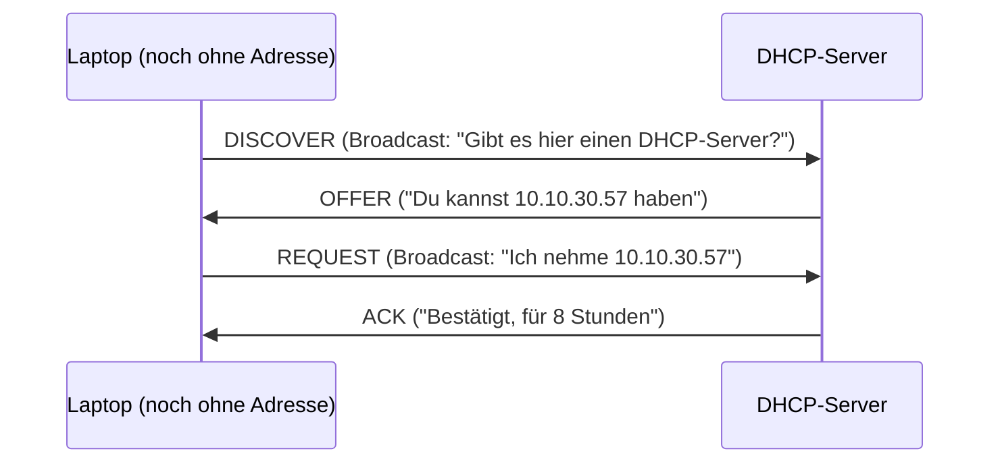
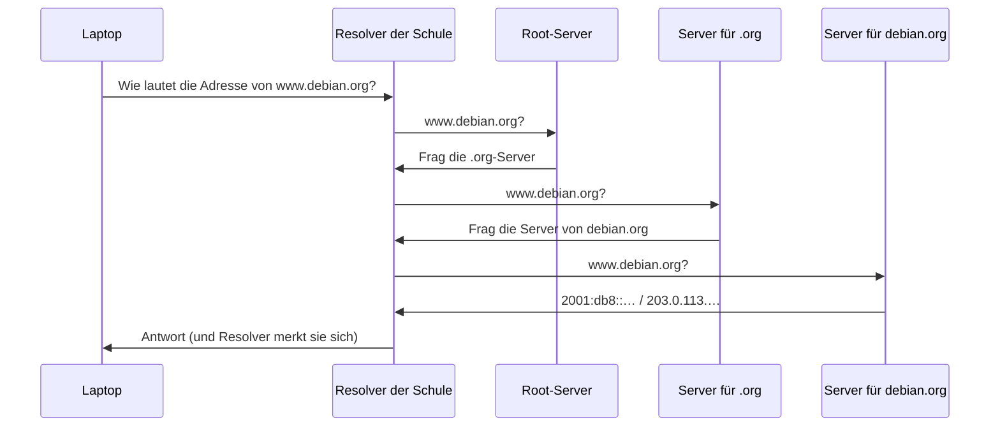

+++
title = "Theorie"
weight = 20
+++

## VLANs: mehrere Netze auf denselben Switches

### Das Problem eines flachen Netzes

Im Packet-Tracer-Netz aus [Einheit 2]({}) hatte jede Gruppe einen **eigenen Switch**: `sw-verw`, `sw-lehr`, `sw-srv`. Das funktioniert für drei Gruppen in einem Raum. Eine echte Schule hat aber acht oder mehr Gruppen (siehe IP-Plan der *Mittelschule Musterstadt*: Verwaltung, Lehrende, Schüler-WLAN, Server, EDV-Raum, Gäste-WLAN, Drucker, Netzwerkmanagement), und in **jedem Stockwerk** stehen Geräte aus fast allen Gruppen.

Ohne Trennung hängen alle Geräte in **einem** Netz:

- Jedes Gerät erreicht jedes andere: Der Laptop eines Schülers kann den Verwaltungsrechner mit den Notenlisten direkt ansprechen.
- Jeder **Broadcast** (z. B. jede DHCP- oder ARP-Anfrage) erreicht alle Geräte. Bei 500 Geräten ist das spürbar.
- Ein Fehler oder ein Schadprogramm auf einem Gerät betrifft sofort das ganze Netz.

Eigene Switches und Kabel pro Gruppe und Stockwerk wären teuer und unflexibel: Zieht die Verwaltung in einen anderen Raum, müsste man umverkabeln.

### Die Lösung: virtuelle Netze

Ein **VLAN** (*Virtual Local Area Network*) teilt einen Switch logisch in mehrere getrennte Switches. Jeder Anschluss (*Port*) gehört zu einem VLAN. Geräte in **verschiedenen** VLANs können einander **nicht** direkt erreichen, auch wenn sie am selben Switch hängen. Für sie ist es, als stünden zwei getrennte Switches im Raum.

Jedes VLAN hat eine Nummer, die **VLAN-ID** (1 bis 4094). Im IP-Plan der *Mittelschule Musterstadt* gilt die Konvention: **drittes Oktett = VLAN-ID**. Ein Blick auf die Adresse verrät also das VLAN:

| VLAN-ID | Name | Netz | Gateway |
|---|---|---|---|
| 10 | Verwaltung | `10.10.10.0/27` | `10.10.10.1` |
| 20 | Lehrende | `10.10.20.0/25` | `10.10.20.1` |
| 30 | Schüler-WLAN | `10.10.30.0/23` | `10.10.30.1` |
| 40 | Server | `10.10.40.0/27` | `10.10.40.1` |
| 60 | Gäste-WLAN | `10.10.60.0/25` | `10.10.60.1` |
| 99 | Netzwerkmanagement | `10.10.99.0/26` | `10.10.99.1` |

**Faustregel:** ein VLAN = ein IP-Netz = ein Broadcast-Bereich.

### Access-Ports und Trunk-Ports

| Port-Art | Wofür | Wie viele VLANs | Rahmen auf dem Kabel |
|---|---|---|---|
| **Access-Port** | Endgerät (PC, Drucker, Access Point für ein einziges Netz) | genau eines | **ohne** Markierung, das Endgerät weiß nichts vom VLAN |
| **Trunk-Port** | Verbindung Switch–Switch, Switch–Router, Switch–Access-Point mit mehreren WLANs | mehrere | **mit** Markierung (*Tag*), damit der Empfänger weiß, zu welchem VLAN der Rahmen gehört |

Die Markierung ist im Standard **IEEE 802.1Q** festgelegt. Der Switch fügt in den Ethernet-Rahmen nach der Absender-MAC-Adresse **4 Byte** ein:

```text
| Ziel-MAC | Absender-MAC | 802.1Q-Tag (4 Byte)              | Typ  | Nutzdaten | Prüfsumme |
                          | TPID 0x8100 | PCP | DEI | VLAN-ID |
                          |   16 Bit    | 3   |  1  | 12 Bit  |
```

- **TPID** `0x8100` kennzeichnet einen Rahmen mit VLAN-Tag.
- **PCP** ist eine Priorität (z. B. für Telefonie).
- **VLAN-ID** hat 12 Bit, daher die Grenze von 4094 nutzbaren VLANs (0 und 4095 sind reserviert).

Auf einem Trunk darf ein VLAN **ohne** Tag übertragen werden, das *Native VLAN* (bei Cisco ab Werk VLAN 1). Das ist eine bekannte Schwachstelle, siehe [Sicherheit]({}).

### Zwischen VLANs: Routing und Zugriffsregeln

Die Lehrerin im VLAN 20 soll trotzdem auf den Server im VLAN 40 zugreifen. Zwischen VLANs vermittelt, wie zwischen allen IP-Netzen, ein **Router** (oder ein **Layer-3-Switch**, der routen kann). Zwei übliche Bauformen:

- **Router on a stick:** Ein einziges Kabel (Trunk) vom Switch zum Router. Der Router hat pro VLAN eine **Unterschnittstelle** (z. B. `Gi0/0.20` für VLAN 20) mit der Gateway-Adresse dieses Netzes.
- **Layer-3-Switch:** Der zentrale Switch hat pro VLAN eine virtuelle Schnittstelle (*SVI*, z. B. `interface vlan 20`) und routet selbst. Üblich in größeren Schulen.

Wichtig: Sobald geroutet wird, können **alle** VLANs einander wieder erreichen. Ein VLAN **trennt**, aber es **verbietet** nichts. Was erlaubt ist, entscheiden **Zugriffsregeln** am Router oder an einer Firewall (bei Cisco: *Access Control Lists*, ACL):

```text
Schüler-WLAN (VLAN 30) ──► Router/Firewall ──► Server (VLAN 40)
                             │
                             └─ Regel: Schüler dürfen nur HTTP/HTTPS und DNS
                                zum Server, nichts in die Verwaltung
```

**Merksatz:** Ein VLAN ist keine Firewall. Es sorgt dafür, dass Verkehr **durch** den Router muss. Erst dort wird entschieden, ob er durchdarf.

### Die Berechtigungsmatrix

Welche Gruppe welchen Dienst in welchem Netz erreichen darf, hält man in einer **Berechtigungsmatrix** fest, bevor man eine einzige Regel schreibt. Die Zeilen sind die Quellen, die Spalten die Ziele:

| von ↓ / nach → | Verwaltung (10) | Lehrende (20) | Server (40) | Internet |
|---|---|---|---|---|
| **Verwaltung (10)** | ja | nein | Datei, Druck, DNS | ja |
| **Lehrende (20)** | nein | ja | Datei, Druck, Web, DNS | ja |
| **Schüler-WLAN (30)** | **nein** | **nein** | nur Web, DNS | ja (gefiltert) |
| **Gäste-WLAN (60)** | nein | nein | nein | ja |

Wie man eine solche Matrix sauber dokumentiert und daraus Regeln ableitet, beschreibt das Dokumentationsskript: [VLAN- und Berechtigungsmatrizen]({}).

### VLANs im WLAN

Ein Access Point kann mehrere WLAN-Namen (**SSIDs**) gleichzeitig ausstrahlen, z. B. `Schule-Lehrende`, `Schule-Schueler`, `Schule-Gast`. Jede SSID wird einem VLAN zugeordnet, der Access Point hängt deshalb an einem **Trunk-Port**. Mit **802.1X** (Anmeldung mit eigenem Konto oder Zertifikat statt gemeinsamem WLAN-Passwort) kann der Anmeldeserver ein Gerät sogar **automatisch** dem richtigen VLAN zuweisen: Dieselbe SSID, aber Lehrende landen in VLAN 20 und Schülerinnen und Schüler in VLAN 30.

## DHCP

### Wozu DHCP?

Jedes Gerät braucht vier Angaben, um im Netz zu arbeiten: **IP-Adresse**, **Netzmaske**, **Gateway** und **DNS-Server**. Bei 500 Geräten, von denen täglich andere kommen und gehen, kann das niemand von Hand eintragen. Das **Dynamic Host Configuration Protocol** (DHCP) verteilt diese Angaben automatisch. Der DHCP-Server **verleiht** eine Adresse für eine bestimmte Zeit (**Lease**). Das Gerät verlängert die Leihe regelmäßig, ein Gerät, das nicht mehr kommt, gibt seine Adresse nach Ablauf frei.

### Der Ablauf: DORA



Der Laptop hat zu Beginn keine Adresse und kennt den Server nicht. Deshalb sind DISCOVER und REQUEST **Broadcasts** an alle im eigenen Netz. Das REQUEST geht ebenfalls als Broadcast, damit andere DHCP-Server mitbekommen, dass ihr Angebot abgelehnt wurde.

### DHCP-Optionen

Neben Adresse und Netzmaske verteilt der Server **Optionen**. Die wichtigsten:

| Option | Inhalt | Beispiel |
|---|---|---|
| 3 | Gateway (*Router*) | `10.10.30.1` |
| 6 | DNS-Server | `10.10.40.10` |
| 15 | Domänenname | `schule.lan` |
| 51 | Lease-Dauer | 8 Stunden |
| 66, 67 | Server und Datei für den **Netzwerkstart** (PXE) | Rechner im EDV-Raum über das Netz neu installieren |

Für Geräte, die immer dieselbe Adresse brauchen (Drucker, Access Points), legt man **Reservierungen** an: Der Server gibt einer bestimmten MAC-Adresse immer dieselbe Adresse.

### DHCP über VLAN-Grenzen: Relay

Broadcasts bleiben im eigenen VLAN. Ein zentraler DHCP-Server im Server-VLAN hört die DISCOVER-Anfrage aus dem Schüler-WLAN also gar nicht. Die Lösung kennst du aus Einheit 2: Der Router arbeitet als **DHCP-Relay** (`ip helper-address 10.10.40.10`). Er nimmt den Broadcast an, schickt ihn gezielt an den Server und trägt dabei seine eigene Adresse im Schüler-VLAN ein (`giaddr`). Daran erkennt der Server, aus **welchem** Netz die Anfrage kommt, und wählt den passenden Adressbereich. So reicht **ein** DHCP-Server für alle VLANs, mit einem Bereich (*Scope*, *Pool*) pro VLAN.

### Fremde DHCP-Server

Jedes Gerät kann sich als DHCP-Server ausgeben, z. B. ein mitgebrachter Heimrouter, der falsch angesteckt wird. Dann bekommen Geräte falsche Adressen oder einen falschen DNS-Server. Switches verhindern das mit **DHCP Snooping**: Nur an bestimmten Ports (zum Router oder Server) dürfen DHCP-Antworten ankommen.

## DNS

### Wozu DNS?

Menschen merken sich Namen, Geräte brauchen Adressen. Das **Domain Name System** (DNS) übersetzt `moodle.schule.lan` in `10.10.40.15` und `debian.org` in eine Adresse im Internet. Ohne funktionierendes DNS scheint „das Internet“ kaputt, obwohl die Verbindung besteht: `ping 1.1.1.1` geht, `ping debian.org` nicht.

### Der Weg einer Anfrage



Es gibt zwei Arten von DNS-Servern:

- Ein **Resolver** (*rekursiver* Server) nimmt Fragen der Geräte an und sucht die Antwort für sie zusammen. Er merkt sich Antworten für eine bestimmte Zeit (**TTL**, *Time to Live*). In der Schule ist das meist der Schulserver oder der Router.
- Ein **autoritativer** Server ist für eine Zone zuständig und kennt deren Einträge verbindlich, z. B. der Server für `schule.lan`.

Statt die ganze Kette selbst zu durchlaufen, kann ein Resolver Anfragen an einen anderen Resolver **weiterleiten** (*Forwarder*), z. B. an den des Internetanbieters. Eine **bedingte Weiterleitung** leitet nur Anfragen für eine bestimmte Domäne an einen bestimmten Server weiter, z. B. alles zu `verwaltung.schule.lan` an den Server der Verwaltung.

### Eintragstypen

| Typ | Bedeutung | Beispiel |
|---|---|---|
| **A** | Name → IPv4-Adresse | `moodle.schule.lan → 10.10.40.15` |
| **AAAA** | Name → IPv6-Adresse | `moodle.schule.lan → fd00::15` |
| **PTR** | Adresse → Name (Rückwärtsauflösung) | `15.40.10.10.in-addr.arpa → moodle.schule.lan` |
| **CNAME** | Alias auf einen anderen Namen | `lernplattform.schule.lan → moodle.schule.lan` |
| **MX** | Mailserver einer Domäne | `schule.at → mail.schule.at` |
| **SRV** | Dienst und Port, z. B. für die Anmeldung am Verzeichnisdienst | `_ldap._tcp.schule.lan → dc.schule.lan:389` |

Die SRV-Einträge sind der Grund, warum eine Windows-Domäne ohne DNS nicht funktioniert: Ein Rechner findet seinen Domänencontroller über `_ldap._tcp.<domäne>` (siehe [Kapitel 4, Verzeichnisdienst]({})).

### Interne Namen

Für Namen, die nur im Schulnetz gelten, verwendet man am besten eine **Subdomain der eigenen, registrierten Domäne**, z. B. `intern.ms-musterstadt.at`. Erfundene Endungen sind riskant: `.local` ist für Multicast-DNS (Apple-Geräte, Drucker) reserviert und führt zu schwer erklärbaren Fehlern. `.test` ist für Übungen reserviert und wird in diesem Kurs verwendet.

### Welchen DNS-Server verwendet mein Gerät?

| System | Befehl | Was du siehst |
|---|---|---|
| Linux (Debian) | `cat /etc/resolv.conf` | Zeilen `nameserver …` und `search …` |
| Linux | `dig debian.org` | Antwort, TTL und in der Zeile `SERVER:` den befragten Resolver |
| Linux | `getent hosts debian.org` | Auflösung so, wie Programme sie sehen (inkl. `/etc/hosts`) |
| Windows | `ipconfig /all` | *DNS-Server* je Netzwerkkarte |
| Windows | `Resolve-DnsName debian.org` bzw. `nslookup debian.org` | Antwort und befragter Server |

## Captive Portal

Im Gäste-WLAN soll sich jemand erst anmelden oder die Nutzungsbedingungen bestätigen, bevor er ins Internet darf. Dafür gibt es das **Captive Portal**:

1. Das Gerät verbindet sich mit dem offenen Gäste-WLAN und bekommt per DHCP eine Adresse.
2. Betriebssysteme prüfen nach dem Verbinden automatisch, ob sie wirklich im Internet sind, indem sie eine bekannte Testadresse ihres Herstellers aufrufen.
3. Das Netz fängt diese Anfrage ab und leitet sie auf die **Anmeldeseite** um. Das Gerät erkennt die Umleitung und öffnet die Anmeldeseite von selbst.
4. Nach der Anmeldung lässt die Firewall das Gerät (meist anhand seiner MAC-Adresse) für eine bestimmte Zeit ins Internet.

Ein Captive Portal ist bequem, aber **keine Verschlüsselung**: In einem offenen WLAN kann jeder mitlesen. Für Lehrende und Schülerinnen und Schüler ist 802.1X die bessere Wahl (siehe [Einheit 2, Sicherheit]({})).

## Ausblick

In [Kapitel 4]({}) baut ihr DHCP und DNS als **Serverrollen** selbst auf, einmal mit Windows Server und einmal mit freier Software unter Linux, und verbindet sie mit einem Verzeichnisdienst, Dateifreigaben und weiteren Rollen zu einem Schulnetz.
