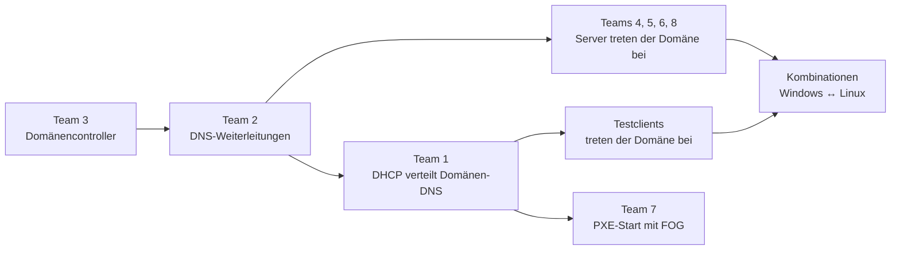

+++
title = "Integration (Einheit 2)"
weight = 30
+++

**Wann:** 23.11.2026, 08:45–11:15 · **Wer:** alle Teams, in der Reihenfolge unten

In Einheit 1 hat jedes Team seine Rolle **für sich** gebaut. Jetzt sollen die Rollen zusammenarbeiten: Die Testclients bekommen per DHCP den DNS-Server ihrer Domäne, melden sich mit Domänenkonten an, verbinden Freigaben und Drucker und starten über das Netz. Das funktioniert nur in der **richtigen Reihenfolge**, weil jede Rolle auf andere wartet. Diese Seite ist der gemeinsame Plan für den Raum. Die Details zu jeder Rolle stehen auf den [Rollenkarten]({}) im Abschnitt *Ziel in Einheit 2*.

{}
Die Befehle wurden noch **nicht** im Proxmox-Labor ausgeführt. *Getestet am: offen.*
{}

## Wer wartet auf wen?

Wer gerade warten muss, arbeitet am [Rollen-Runbook]({}) weiter oder bereitet die [Rollenpräsentation]({}) vor.

## Startcheck um 08:45 (5 min)

Bevor irgendjemand einer Domäne beitritt, prüft jedes Team kurz seine eigene Rolle vom Stand der Einheit 1. Die Lehrperson sammelt die Ergebnisse an der Tafel.

| Prüfung | Wer | Befehl | Erwartet |
|---|---|---|---|
| Windows-DC antwortet | Team 3 | `Resolve-DnsName _ldap._tcp.win.schule.lan -Type SRV -Server 10.50.13.12` | SRV-Eintrag mit `dc.win.schule.lan` |
| Samba-DC antwortet | Team 3 | `host -t SRV _ldap._tcp.linux.schule.lan 10.50.13.23` | SRV-Eintrag mit `dc.linux.schule.lan` |
| Uhrzeit stimmt | Team 3 | `w32tm /query /status` bzw. `timedatectl` | Abweichung unter 5 Minuten zu den anderen Servern |
| DNS-Zonen da | Team 2 | `dig @10.50.13.11 win-dhcp.labor.test` und `dig @10.50.13.22 -x 10.50.13.10` | Antworten mit Adresse bzw. Name |
| DHCP mit Filter | Team 1 | Testclients erneuern ihre Adresse | Windows `.100–.119`, Linux `.120–.139` |
| Alle anderen | Teams 4–8 | Abnahmetest aus der Rollenkarte, lokal | wie in Einheit 1 |

## Schritt 1: DNS zwischen den Welten (08:50–09:05)

**Team 2 und Team 3 gemeinsam.** Ziel: Jeder DNS-Server im Labor findet jeden Namen, egal in welcher Welt er steht.

| Server | Fragt nach … | … wird weitergeleitet an |
|---|---|---|
| Windows-DC `10.50.13.12` | `linux.schule.lan` | `10.50.13.23` (Samba-DC) |
| Windows-DC `10.50.13.12` | `labor.test`, `13.50.10.in-addr.arpa` | `10.50.13.11` bzw. `10.50.13.22` |
| Samba-DC `10.50.13.23` | **alles**, was nicht `linux.schule.lan` ist | `10.50.13.22` (BIND) |
| BIND `10.50.13.22` | `win.schule.lan` | `10.50.13.12` |
| BIND `10.50.13.22` | `linux.schule.lan` | `10.50.13.23` |
| BIND `10.50.13.22` | `labor.test` | sekundäre Zone von `10.50.13.11` |
| Windows-DNS `10.50.13.11` | `win.schule.lan`, `linux.schule.lan` | `10.50.13.12` bzw. `10.50.13.23` |
| alle | alles andere | `10.50.13.254` (Labor-Router) |

Hinweise:

- Windows: `Add-DnsServerConditionalForwarderZone -Name linux.schule.lan -MasterServers 10.50.13.23`.
- Der interne DNS-Server von Samba kennt **keine bedingten Weiterleitungen**, nur eine allgemeine (`dns forwarder` in `smb.conf`). Deshalb leitet Samba alles an BIND, und BIND verteilt weiter. Team 3 ändert dazu die Weiterleitung von `10.50.13.254` auf `10.50.13.22`.
- BIND: Weiterleitungszonen (`zone "win.schule.lan" { type forward; forward only; forwarders { 10.50.13.12; }; };`).

{}
BIND prüft Antworten ab Werk mit **DNSSEC**. Die Endungen `.lan` und `.test` gibt es im Internet nicht, und die Root-Server können das beweisen. BIND verwirft deshalb die Antworten der Domänencontroller und meldet `SERVFAIL`. Abhilfe in `named.conf.options`: `validate-except { "lan"; "test"; };`. An einer echten Schule mit einer registrierten Domäne (z. B. `intern.ms-musterstadt.at`) tritt das Problem nicht auf.
{}

**Abnahme:** Von **jedem** der vier DNS-Server aus lassen sich `dc.win.schule.lan`, `dc.linux.schule.lan`, `lx-web.labor.test` und `debian.org` auflösen.

## Schritt 2: Server und Clients zeigen auf ihre Domäne (09:05–09:20)

**Team 1** stellt die DHCP-Option DNS-Server um: Windows-Bereich auf `10.50.13.12`, Kea auf `10.50.13.23`, dazu Option 15 (Domänenname) `win.schule.lan` bzw. `linux.schule.lan`. Windows-DHCP wird im Active Directory **autorisiert**, sobald der Server der Domäne beigetreten ist.

**Alle Teams** stellen den DNS-Server ihrer Server um:

| Welt | Neuer DNS-Server | Befehl |
|---|---|---|
| Windows (`.10–.17`) | `10.50.13.12` | `Set-DnsClientServerAddress -InterfaceAlias Ethernet -ServerAddresses 10.50.13.12` |
| Linux-VMs (`.23`, `.27`) | `10.50.13.23` | `/etc/resolv.conf` bzw. Netzwerkkonfiguration |
| Linux-Container (`.21–.28`) | `10.50.13.23` | `/etc/resolv.conf` (siehe Hinweis) |

{}
Proxmox schreibt `/etc/resolv.conf` eines Containers bei jedem Start neu. Damit eure Änderung bleibt, legt im Container die Datei `/etc/.pve-ignore.resolv.conf` an (`touch /etc/.pve-ignore.resolv.conf`).
{}

## Schritt 3: Domänenbeitritt (09:20–10:15)

Team 3 unterstützt. Reihenfolge innerhalb der Welt: zuerst die Testclients (zeigt, dass die Domäne funktioniert), dann die Server.

| Maschine | Domäne | Wie | Wer |
|---|---|---|---|
| Windows-Testclient | `win.schule.lan` | `Add-Computer -DomainName win.schule.lan -Restart` | Team 3 |
| Linux-Testclient | `linux.schule.lan` | `realm join linux.schule.lan -U administrator` (Pakete `realmd`, `sssd`, `adcli`) | Team 3 |
| `.10` DHCP (Windows) | `win.schule.lan` | `Add-Computer`, danach `Add-DhcpServerInDC` | Team 1 |
| `.13` Dateifreigaben | `win.schule.lan` | `Add-Computer`, Rechte auf Domänengruppen umstellen | Team 4 |
| `.24` Samba-Freigaben | `linux.schule.lan` | als *Domain Member* mit `winbind` (nicht `realm`/`sssd`, weil Samba Freigaben anbietet) | Team 4 |
| `.14` / `.25` Drucken | ihre Domäne | wie oben | Team 5 |
| `.15` IIS | `win.schule.lan` | `Add-Computer`, dann *Windows-Authentifizierung* | Team 6 |
| `.17` / `.28` Fernzugriff | ihre Domäne | Windows `Add-Computer`, Linux `realm join` | Team 8 |

**Abnahme pro Welt:** Am Testclient meldet sich `lehrer01` mit Domänenkonto an, und `whoami /groups` bzw. `id lehrer01@linux.schule.lan` zeigt die Gruppe `GG-Lehrende`.

Parallel dazu (wartet nur auf Team 1): **Team 1 und Team 7** richten den PXE-Start ein (Optionen 66 und 67 für die MAC-Adressen von Team 7), siehe [Client-Verteilung]({}).

## Schritt 4: Kombinationen Windows ↔ Linux (10:30–11:15)

Jetzt wird es interessant: Funktioniert eine Rolle auch für die **andere** Welt? Jedes Team testet seine Zeilen und trägt das Ergebnis (✅ / ❌ mit kurzem Grund) in die gemeinsame Tabelle ein, die die Lehrperson projiziert.

| # | Kombination | Team | Test | Ergebnis |
|---|---|---|---|---|
| 1 | Namen über Weltgrenzen | 2 | Windows-Testclient löst `dc.linux.schule.lan` auf, Linux-Testclient `dc.win.schule.lan` | |
| 2 | Linux-Client bekommt Adresse von Windows-DHCP | 1 | MAC-Adressen in den Zulassungslisten tauschen, Adresse erneuern | |
| 3 | Linux-Rechner tritt Active Directory bei | 3 | ein Linux-Container: `realm join win.schule.lan`, Anmeldung als `WINSCHULE\lehrer01` | |
| 4 | Windows-Client nutzt Samba-Freigabe | 4 | `\\10.50.13.24\Klassen` als Laufwerk | |
| 5 | Linux-Client nutzt Windows-Freigabe | 4 | `mount -t cifs //10.50.13.13/Klassen …` | |
| 6 | Windows-Client druckt auf CUPS | 5 | Drucker per IPP-Adresse hinzufügen, Testseite | |
| 7 | Linux-Client druckt auf Windows-Druckserver | 5 | Drucker in CUPS bzw. den Druckeinstellungen hinzufügen | |
| 8 | Windows-Client öffnet Linux-Desktop | 8 | `mstsc /v:10.50.13.28` (xrdp) | |
| 9 | Linux-Client öffnet Windows-Desktop | 8 | Remmina auf `10.50.13.17` | |
| 10 | SSH auf Windows | 8 | `ssh lehrer01@10.50.13.17` (OpenSSH-Server unter Windows) | |
| 11 | FOG verteilt Windows-Abbild | 7 | Zielrechner startet über PXE, Abbild von `.16` wird verteilt | |
| 12 | Eine Webseite, beide Clients | 6 | `https://intranet-win.labor.test` vom Linux-Client, `https://intranet-lx.labor.test` vom Windows-Client | |

Dazwischen (ca. 15 min) zeigt die Lehrperson die [Demo Zertifikatsdienste]({}): Danach sollte Zeile 12 ohne Browserwarnung funktionieren.

Die ausgefüllte Tabelle ist Grundlage für die Abschlussrunde nach den Präsentationen: **Wo hat die Kombination ohne Aufwand funktioniert, wo nicht, und warum?** Fast alles, was funktioniert, funktioniert über **offene, dokumentierte Protokolle** (DHCP, DNS, LDAP, Kerberos, SMB, IPP, RDP, SSH, PXE).

## Wenn die Anmeldung an der Domäne nicht klappt

Fehlersuche **in dieser Reihenfolge**, das löst die meisten Fälle:

1. **Netz:** `ping 10.50.13.12` bzw. `10.50.13.23`.
2. **DNS-Server des Clients:** Zeigt er auf den Domänencontroller? (`ipconfig /all`, `cat /etc/resolv.conf`)
3. **SRV-Eintrag:** `Resolve-DnsName _ldap._tcp.<domäne> -Type SRV` bzw. `host -t SRV _ldap._tcp.<domäne>`.
4. **Uhrzeit:** Weichen Client und DC mehr als 5 Minuten ab, scheitert Kerberos mit einer wenig hilfreichen Meldung.
5. **Konto und Kennwort:** Großschreibung des Bereichs bei `kinit` (`lehrer01@LINUX.SCHULE.LAN`).
6. Erst dann: Protokolle des Domänencontrollers (Ereignisanzeige *Directory Service* bzw. `journalctl -u samba-ad-dc`).
