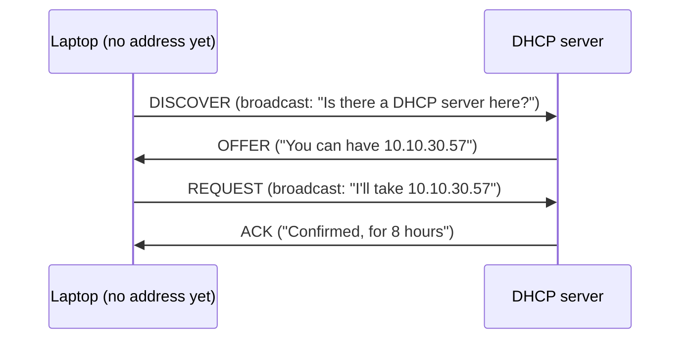
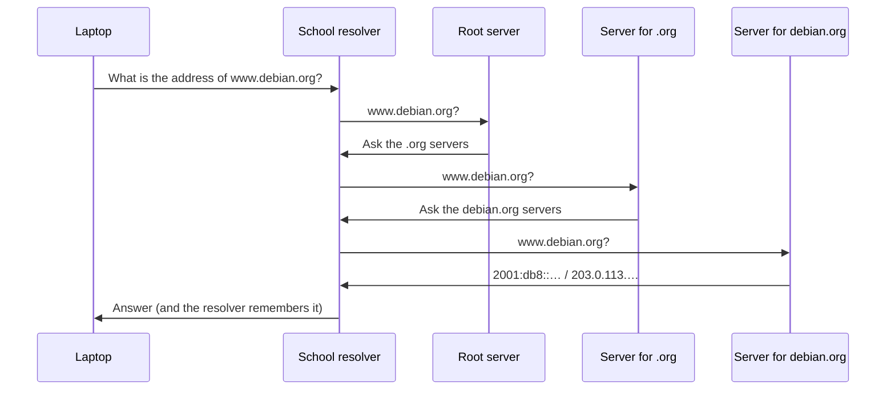

+++
title = "Theory"
weight = 20
+++

## VLANs: several networks on the same switches

### The problem with a flat network

In the Packet Tracer network from [session 2]({}), every group had its **own switch**: `sw-verw`, `sw-lehr`, `sw-srv`. That works for three groups in one room. A real school, however, has eight or more groups (see the IP plan of *Mittelschule Musterstadt*: administration, teachers, student Wi-Fi, servers, computer lab, guest Wi-Fi, printers, network management), and on **every floor** there are devices from almost all groups.

Without separation, all devices are in **one** network:

- Every device reaches every other one: a student's laptop can directly address the administration PC with the grade lists.
- Every **broadcast** (e.g. every DHCP or ARP request) reaches all devices. With 500 devices, that is noticeable.
- A fault or malware on one device immediately affects the whole network.

Separate switches and cables per group and floor would be expensive and inflexible: if the administration moves to another room, you would have to rewire.

### The solution: virtual networks

A **VLAN** (*Virtual Local Area Network*) logically divides a switch into several separate switches. Every port belongs to a VLAN. Devices in **different** VLANs **cannot** reach each other directly, even if they are connected to the same switch. For them it is as if there were two separate switches in the room.

Every VLAN has a number, the **VLAN ID** (1 to 4094). The IP plan of *Mittelschule Musterstadt* uses the convention: **third octet = VLAN ID**. A glance at the address tells you the VLAN:

| VLAN ID | Name | Network | Gateway |
|---|---|---|---|
| 10 | Administration | `10.10.10.0/27` | `10.10.10.1` |
| 20 | Teachers | `10.10.20.0/25` | `10.10.20.1` |
| 30 | Student Wi-Fi | `10.10.30.0/23` | `10.10.30.1` |
| 40 | Servers | `10.10.40.0/27` | `10.10.40.1` |
| 60 | Guest Wi-Fi | `10.10.60.0/25` | `10.10.60.1` |
| 99 | Network management | `10.10.99.0/26` | `10.10.99.1` |

**Rule of thumb:** one VLAN = one IP network = one broadcast domain.

### Access ports and trunk ports

| Port type | Used for | How many VLANs | Frames on the cable |
|---|---|---|---|
| **Access port** | End device (PC, printer, access point for a single network) | exactly one | **without** a marker, the end device knows nothing about the VLAN |
| **Trunk port** | Switch–switch, switch–router, switch–access point with several Wi-Fi networks | several | **with** a marker (*tag*) so the receiver knows which VLAN the frame belongs to |

The marker is defined in the **IEEE 802.1Q** standard. The switch inserts **4 bytes** into the Ethernet frame after the source MAC address:

```text
| Dest. MAC | Source MAC | 802.1Q tag (4 bytes)             | Type | Payload | Checksum |
                         | TPID 0x8100 | PCP | DEI | VLAN ID |
                         |   16 bits   | 3   |  1  | 12 bits |
```

- **TPID** `0x8100` marks a frame with a VLAN tag.
- **PCP** is a priority (e.g. for telephony).
- **VLAN ID** has 12 bits, hence the limit of 4094 usable VLANs (0 and 4095 are reserved).

On a trunk, one VLAN may be transmitted **without** a tag, the *native VLAN* (VLAN 1 by default on Cisco). This is a known weakness, see [security]({}).

### Between VLANs: routing and access rules

The teacher in VLAN 20 should still be able to access the server in VLAN 40. Between VLANs, as between all IP networks, a **router** (or a **layer-3 switch** that can route) forwards traffic. Two common designs:

- **Router on a stick:** a single cable (trunk) from the switch to the router. The router has one **subinterface** per VLAN (e.g. `Gi0/0.20` for VLAN 20) with the gateway address of that network.
- **Layer-3 switch:** the core switch has one virtual interface per VLAN (*SVI*, e.g. `interface vlan 20`) and routes itself. Common in larger schools.

Important: as soon as traffic is routed, **all** VLANs can reach each other again. A VLAN **separates**, but it does not **forbid** anything. What is allowed is decided by **access rules** on the router or a firewall (on Cisco: *Access Control Lists*, ACL):

```text
Student Wi-Fi (VLAN 30) ──► Router/firewall ──► Servers (VLAN 40)
                              │
                              └─ Rule: students may only use HTTP/HTTPS and DNS
                                 to the server, nothing into the administration
```

**Key point:** a VLAN is not a firewall. It makes sure that traffic has to go **through** the router. Only there is it decided whether it may pass.

### The permission matrix

Which group may reach which service in which network is recorded in a **permission matrix** before a single rule is written. The rows are the sources, the columns the destinations:

| from ↓ / to → | Administration (10) | Teachers (20) | Servers (40) | Internet |
|---|---|---|---|---|
| **Administration (10)** | yes | no | file, print, DNS | yes |
| **Teachers (20)** | no | yes | file, print, web, DNS | yes |
| **Student Wi-Fi (30)** | **no** | **no** | web and DNS only | yes (filtered) |
| **Guest Wi-Fi (60)** | no | no | no | yes |

How to document such a matrix properly and derive rules from it is described in the documentation script: [VLAN and permission matrices]({}).

### VLANs in Wi-Fi

An access point can broadcast several Wi-Fi names (**SSIDs**) at the same time, e.g. `School-Teachers`, `School-Students`, `School-Guest`. Each SSID is assigned to a VLAN, so the access point is connected to a **trunk port**. With **802.1X** (login with a personal account or certificate instead of a shared Wi-Fi password), the authentication server can even assign a device to the right VLAN **automatically**: the same SSID, but teachers end up in VLAN 20 and students in VLAN 30.

## DHCP

### Why DHCP?

Every device needs four settings to work in the network: **IP address**, **subnet mask**, **gateway** and **DNS server**. With 500 devices, different ones coming and going every day, nobody can enter these by hand. The **Dynamic Host Configuration Protocol** (DHCP) distributes these settings automatically. The DHCP server **lends** an address for a certain time (**lease**). The device renews the lease regularly; a device that no longer shows up releases its address when the lease expires.

### The sequence: DORA



At the start the laptop has no address and does not know the server. That is why DISCOVER and REQUEST are **broadcasts** to everyone in the local network. The REQUEST is also a broadcast so that other DHCP servers learn that their offer was declined.

### DHCP options

Besides address and subnet mask, the server distributes **options**. The most important ones:

| Option | Content | Example |
|---|---|---|
| 3 | Gateway (*router*) | `10.10.30.1` |
| 6 | DNS server | `10.10.40.10` |
| 15 | Domain name | `schule.lan` |
| 51 | Lease time | 8 hours |
| 66, 67 | Server and file for **network boot** (PXE) | reinstalling computer-lab PCs over the network |

For devices that always need the same address (printers, access points), you create **reservations**: the server always gives a specific MAC address the same IP address.

### DHCP across VLAN boundaries: relay

Broadcasts stay in their own VLAN. A central DHCP server in the server VLAN therefore never hears the DISCOVER from the student Wi-Fi. You know the solution from session 2: the router acts as a **DHCP relay** (`ip helper-address 10.10.40.10`). It accepts the broadcast, sends it directly to the server and adds its own address in the student VLAN (`giaddr`). From this the server recognizes **which** network the request comes from and picks the matching address range. So **one** DHCP server is enough for all VLANs, with one range (*scope*, *pool*) per VLAN.

### Rogue DHCP servers

Any device can pretend to be a DHCP server, e.g. a home router someone brings along and plugs in wrongly. Devices then get wrong addresses or a wrong DNS server. Switches prevent this with **DHCP snooping**: DHCP replies are only accepted on specific ports (towards the router or server).

## DNS

### Why DNS?

People remember names, devices need addresses. The **Domain Name System** (DNS) translates `moodle.schule.lan` into `10.10.40.15` and `debian.org` into an address on the internet. Without working DNS, "the internet" seems broken even though the connection is there: `ping 1.1.1.1` works, `ping debian.org` does not.

### The path of a query



There are two kinds of DNS servers:

- A **resolver** (*recursive* server) accepts questions from devices and puts the answer together for them. It remembers answers for a certain time (**TTL**, *time to live*). In a school this is usually the school server or the router.
- An **authoritative** server is responsible for a zone and knows its records definitively, e.g. the server for `schule.lan`.

Instead of walking the whole chain itself, a resolver can **forward** queries to another resolver (*forwarder*), e.g. the internet provider's. A **conditional forwarder** only forwards queries for a specific domain to a specific server, e.g. everything for `verwaltung.schule.lan` to the administration's server.

### Record types

| Type | Meaning | Example |
|---|---|---|
| **A** | Name → IPv4 address | `moodle.schule.lan → 10.10.40.15` |
| **AAAA** | Name → IPv6 address | `moodle.schule.lan → fd00::15` |
| **PTR** | Address → name (reverse lookup) | `15.40.10.10.in-addr.arpa → moodle.schule.lan` |
| **CNAME** | Alias for another name | `lernplattform.schule.lan → moodle.schule.lan` |
| **MX** | Mail server of a domain | `schule.at → mail.schule.at` |
| **SRV** | Service and port, e.g. for logging in to the directory service | `_ldap._tcp.schule.lan → dc.schule.lan:389` |

The SRV records are the reason a Windows domain does not work without DNS: a computer finds its domain controller via `_ldap._tcp.<domain>` (see [chapter 4, directory service]({})).

### Internal names

For names that only apply in the school network, it is best to use a **subdomain of your own registered domain**, e.g. `intern.ms-musterstadt.at`. Made-up endings are risky: `.local` is reserved for multicast DNS (Apple devices, printers) and leads to errors that are hard to explain. `.test` is reserved for exercises and is used in this course.

### Which DNS server does my device use?

| System | Command | What you see |
|---|---|---|
| Linux (Debian) | `cat /etc/resolv.conf` | lines `nameserver …` and `search …` |
| Linux | `dig debian.org` | answer, TTL and, in the `SERVER:` line, the resolver that was asked |
| Linux | `getent hosts debian.org` | resolution as programs see it (including `/etc/hosts`) |
| Windows | `ipconfig /all` | *DNS servers* per network adapter |
| Windows | `Resolve-DnsName debian.org` or `nslookup debian.org` | answer and the server that was asked |

## Captive portal

In the guest Wi-Fi, someone should log in or accept the terms of use before getting onto the internet. That is what a **captive portal** does:

1. The device connects to the open guest Wi-Fi and gets an address via DHCP.
2. After connecting, operating systems automatically check whether they are really on the internet by calling a well-known test address of their vendor.
3. The network intercepts this request and redirects it to the **login page**. The device notices the redirect and opens the login page by itself.
4. After login, the firewall lets the device (usually identified by its MAC address) onto the internet for a certain time.

A captive portal is convenient, but it is **not encryption**: in an open Wi-Fi, anyone can listen in. For teachers and students, 802.1X is the better choice (see [session 2, security]({})).

## Outlook

In [chapter 4]({}) you build DHCP and DNS as **server roles** yourselves, once with Windows Server and once with free software on Linux, and connect them with a directory service, file shares and other roles into a school network.
