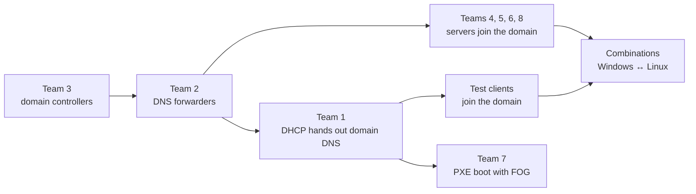

+++
title = "Integration (session 2)"
weight = 30
+++

**When:** 23.11.2026, 08:45–11:15 · **Who:** all teams, in the order below

In session 1 each team built its role **on its own**. Now the roles should work together: the test clients get the DNS server of their domain via DHCP, log in with domain accounts, connect shares and printers and boot from the network. This only works in the **right order**, because every role waits for others. This page is the shared plan for the room. The details for each role are on the [role cards]({}) in the section *Goal in session 2*.

{}
The commands have **not** yet been run in the Proxmox lab. *Tested on: open.*
{}

## Who waits for whom?

Whoever has to wait works on the [role runbook]({}) or prepares the [role presentation]({}).

## Start check at 08:45 (5 min)

Before anyone joins a domain, each team briefly checks its own role from the state of session 1. The lecturer collects the results on the board.

| Check | Who | Command | Expected |
|---|---|---|---|
| Windows DC answers | team 3 | `Resolve-DnsName _ldap._tcp.win.schule.lan -Type SRV -Server 10.50.13.12` | SRV record with `dc.win.schule.lan` |
| Samba DC answers | team 3 | `host -t SRV _ldap._tcp.linux.schule.lan 10.50.13.23` | SRV record with `dc.linux.schule.lan` |
| Time is correct | team 3 | `w32tm /query /status` or `timedatectl` | difference below 5 minutes to the other servers |
| DNS zones present | team 2 | `dig @10.50.13.11 win-dhcp.labor.test` and `dig @10.50.13.22 -x 10.50.13.10` | answers with address or name |
| DHCP with filter | team 1 | test clients renew their address | Windows `.100–.119`, Linux `.120–.139` |
| All others | teams 4–8 | acceptance test from the role card, locally | as in session 1 |

## Step 1: DNS between the worlds (08:50–09:05)

**Team 2 and team 3 together.** Goal: every DNS server in the lab finds every name, no matter which world it is in.

| Server | Asked for … | … is forwarded to |
|---|---|---|
| Windows DC `10.50.13.12` | `linux.schule.lan` | `10.50.13.23` (Samba DC) |
| Windows DC `10.50.13.12` | `labor.test`, `13.50.10.in-addr.arpa` | `10.50.13.11` or `10.50.13.22` |
| Samba DC `10.50.13.23` | **everything** that is not `linux.schule.lan` | `10.50.13.22` (BIND) |
| BIND `10.50.13.22` | `win.schule.lan` | `10.50.13.12` |
| BIND `10.50.13.22` | `linux.schule.lan` | `10.50.13.23` |
| BIND `10.50.13.22` | `labor.test` | secondary zone from `10.50.13.11` |
| Windows DNS `10.50.13.11` | `win.schule.lan`, `linux.schule.lan` | `10.50.13.12` or `10.50.13.23` |
| all | everything else | `10.50.13.254` (lab router) |

Hints:

- Windows: `Add-DnsServerConditionalForwarderZone -Name linux.schule.lan -MasterServers 10.50.13.23`.
- Samba's internal DNS server has **no conditional forwarders**, only a general one (`dns forwarder` in `smb.conf`). That is why Samba forwards everything to BIND, and BIND distributes further. For this, team 3 changes the forwarder from `10.50.13.254` to `10.50.13.22`.
- BIND: forward zones (`zone "win.schule.lan" { type forward; forward only; forwarders { 10.50.13.12; }; };`).

{}
By default, BIND validates answers with **DNSSEC**. The endings `.lan` and `.test` do not exist on the internet, and the root servers can prove that. BIND therefore discards the domain controllers' answers and reports `SERVFAIL`. Fix in `named.conf.options`: `validate-except { "lan"; "test"; };`. At a real school with a registered domain (e.g. `intern.ms-musterstadt.at`) the problem does not occur.
{}

**Acceptance:** from **each** of the four DNS servers, `dc.win.schule.lan`, `dc.linux.schule.lan`, `lx-web.labor.test` and `debian.org` can be resolved.

## Step 2: servers and clients point to their domain (09:05–09:20)

**Team 1** changes the DNS server DHCP option: Windows scope to `10.50.13.12`, Kea to `10.50.13.23`, plus option 15 (domain name) `win.schule.lan` or `linux.schule.lan`. Windows DHCP is **authorized** in Active Directory as soon as the server has joined the domain.

**All teams** change the DNS server of their servers:

| World | New DNS server | Command |
|---|---|---|
| Windows (`.10–.17`) | `10.50.13.12` | `Set-DnsClientServerAddress -InterfaceAlias Ethernet -ServerAddresses 10.50.13.12` |
| Linux VMs (`.23`, `.27`) | `10.50.13.23` | `/etc/resolv.conf` or network configuration |
| Linux containers (`.21–.28`) | `10.50.13.23` | `/etc/resolv.conf` (see note) |

{}
Proxmox rewrites a container's `/etc/resolv.conf` at every start. To keep your change, create the file `/etc/.pve-ignore.resolv.conf` in the container (`touch /etc/.pve-ignore.resolv.conf`).
{}

## Step 3: domain join (09:20–10:15)

Team 3 supports. Order within each world: first the test clients (shows that the domain works), then the servers.

| Machine | Domain | How | Who |
|---|---|---|---|
| Windows test client | `win.schule.lan` | `Add-Computer -DomainName win.schule.lan -Restart` | team 3 |
| Linux test client | `linux.schule.lan` | `realm join linux.schule.lan -U administrator` (packages `realmd`, `sssd`, `adcli`) | team 3 |
| `.10` DHCP (Windows) | `win.schule.lan` | `Add-Computer`, then `Add-DhcpServerInDC` | team 1 |
| `.13` file shares | `win.schule.lan` | `Add-Computer`, switch permissions to domain groups | team 4 |
| `.24` Samba shares | `linux.schule.lan` | as a *domain member* with `winbind` (not `realm`/`sssd`, because Samba offers shares) | team 4 |
| `.14` / `.25` printing | their domain | as above | team 5 |
| `.15` IIS | `win.schule.lan` | `Add-Computer`, then *Windows Authentication* | team 6 |
| `.17` / `.28` remote access | their domain | Windows `Add-Computer`, Linux `realm join` | team 8 |

**Acceptance per world:** on the test client, `lehrer01` logs in with a domain account, and `whoami /groups` or `id lehrer01@linux.schule.lan` shows the group `GG-Lehrende`.

In parallel (only waits for team 1): **team 1 and team 7** set up PXE boot (options 66 and 67 for team 7's MAC addresses), see [client deployment]({}).

## Step 4: combinations Windows ↔ Linux (10:30–11:15)

Now it gets interesting: does a role also work for the **other** world? Each team tests its rows and enters the result (✅ / ❌ with a short reason) in the shared table the lecturer projects.

| # | Combination | Team | Test | Result |
|---|---|---|---|---|
| 1 | Names across worlds | 2 | Windows test client resolves `dc.linux.schule.lan`, Linux test client `dc.win.schule.lan` | |
| 2 | Linux client gets an address from Windows DHCP | 1 | swap MAC addresses in the allow lists, renew the address | |
| 3 | Linux machine joins Active Directory | 3 | a Linux container: `realm join win.schule.lan`, login as `WINSCHULE\lehrer01` | |
| 4 | Windows client uses a Samba share | 4 | `\\10.50.13.24\Klassen` as a drive | |
| 5 | Linux client uses a Windows share | 4 | `mount -t cifs //10.50.13.13/Klassen …` | |
| 6 | Windows client prints to CUPS | 5 | add printer by IPP address, test page | |
| 7 | Linux client prints to the Windows print server | 5 | add printer in CUPS or the printer settings | |
| 8 | Windows client opens a Linux desktop | 8 | `mstsc /v:10.50.13.28` (xrdp) | |
| 9 | Linux client opens a Windows desktop | 8 | Remmina to `10.50.13.17` | |
| 10 | SSH to Windows | 8 | `ssh lehrer01@10.50.13.17` (OpenSSH server on Windows) | |
| 11 | FOG deploys a Windows image | 7 | target machine boots via PXE, image from `.16` is deployed | |
| 12 | One website, both clients | 6 | `https://intranet-win.labor.test` from the Linux client, `https://intranet-lx.labor.test` from the Windows client | |

In between (approx. 15 min), the lecturer shows the [certificate services demo]({}): afterwards, row 12 should work without a browser warning.

The completed table is the basis for the closing round after the presentations: **where did the combination work without effort, where not, and why?** Almost everything that works, works over **open, documented protocols** (DHCP, DNS, LDAP, Kerberos, SMB, IPP, RDP, SSH, PXE).

## If logging in to the domain does not work

Troubleshoot **in this order**; it solves most cases:

1. **Network:** `ping 10.50.13.12` or `10.50.13.23`.
2. **The client's DNS server:** does it point to the domain controller? (`ipconfig /all`, `cat /etc/resolv.conf`)
3. **SRV record:** `Resolve-DnsName _ldap._tcp.<domain> -Type SRV` or `host -t SRV _ldap._tcp.<domain>`.
4. **Time:** if client and DC differ by more than 5 minutes, Kerberos fails with an unhelpful message.
5. **Account and password:** upper-case realm with `kinit` (`lehrer01@LINUX.SCHULE.LAN`).
6. Only then: the domain controller's logs (Event Viewer *Directory Service* or `journalctl -u samba-ad-dc`).
